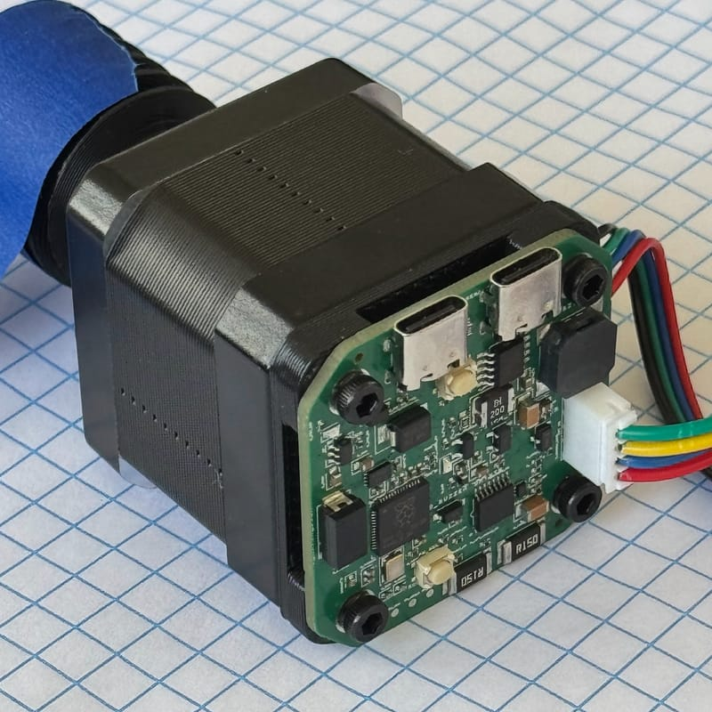
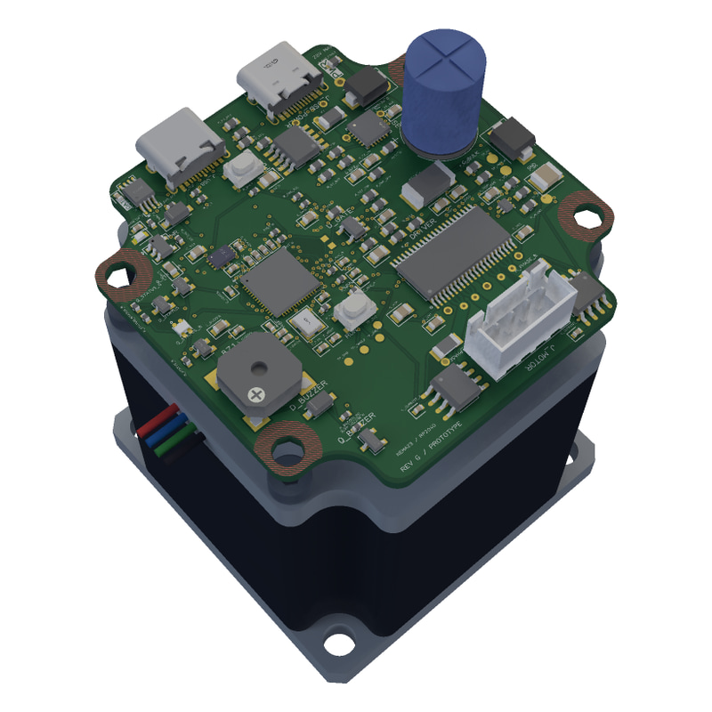
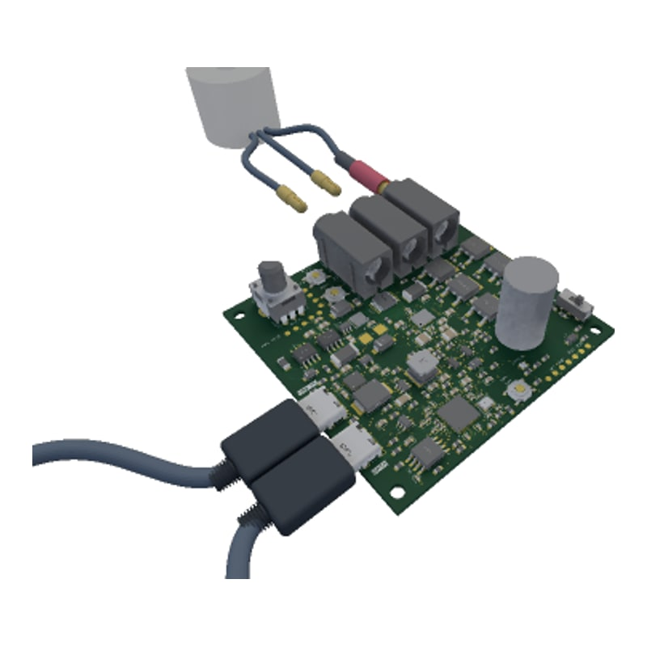
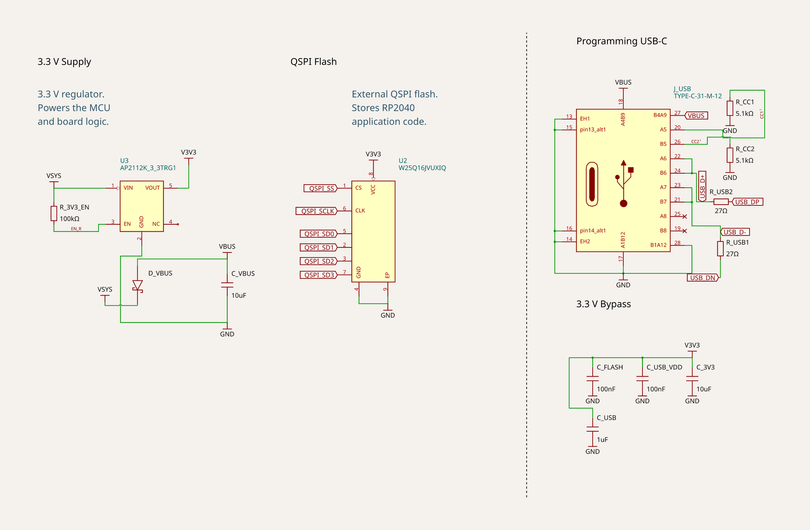
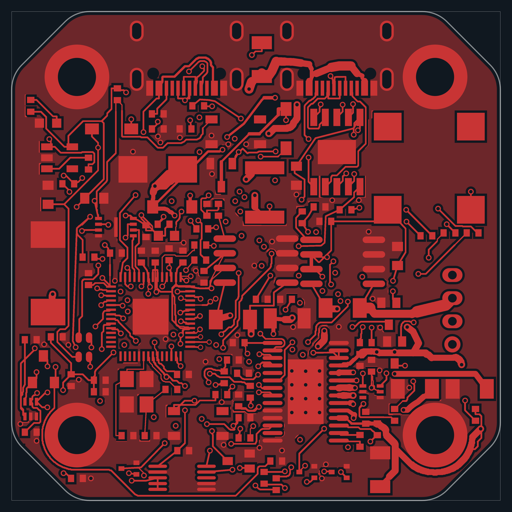

# tscircuit - React for Circuits

**Design circuit boards with TypeScript and React.**

tscircuit is an open-source electronics design tool. Describe components and connections in code, preview your schematic and PCB in 2D and 3D, and export manufacturing files to order real boards.

Use your favorite editor and AI coding tools, or [try it in your browser](https://tscircuit.com/playground).

Get started with `npm install -g tscircuit`. [CLI quickstart →](https://docs.tscircuit.com/intro/quickstart-cli)

<div>
<a href="https://tscircuit.com/join" target="_blank">Discord</a>
·
<a href="https://tscircuit.com" target="_blank">Website</a>
·
<a href="https://docs.tscircuit.com" target="_blank">Docs</a>
·
<a href="https://blog.tscircuit.com/" target="_blank">Blog</a>
·
<a href="https://tscircuit.com/playground" target="_blank">Online Playground</a>
·
<a href="https://docs.tscircuit.com/quickstart" target="_blank">Quick Start</a>
·
<a href="https://github.com/tscircuit/tscircuit/issues" target="_blank">Issues</a>
·
<a href="https://x.com/tscircuit" target="_blank">Twitter</a>
·
<a href="https://docs.tscircuit.com/llms.txt">llms.txt</a>
·
<a href="https://share.cleanshot.com/XkJKK2ys">Getting Started Contributor Video</a>

</div>
<br/>

<div style="display: flex; gap: 10px">
  <a href="https://console.algora.io/org/tscircuit/bounties?status=completed">
       
   </a>
   <a href="https://console.algora.io/org/tscircuit/bounties?status=open">
       
   </a>
  <a target="_blank" href="https://tscircuit.com/join"></a>
  <a target="_blank" href="https://www.npmjs.com/package/tscircuit"></a>
  <a target="_blank" href="https://github.com/tscircuit/tscircuit/stargazers"></a>
</div>

## Example Circuits

From code to hardware: explore the source, schematic, PCB layout, and 3D view of these community projects.

<table>
  <tr>
    <td align="center" width="33%">
      <a href="https://tscircuit.com/imrishabh18/rp2040-motor-controller#files">
        
      </a>
      <br />
      <strong><a href="https://tscircuit.com/imrishabh18/rp2040-motor-controller#files">RP2040 motor controller</a></strong>
      <br />
      USB-C motor control · Manufactured board
      <br />
      by <a href="https://tscircuit.com/imrishabh18">imrishabh18</a>
    </td>
    <td align="center" width="33%">
      <a href="https://tscircuit.com/imrishabh18/nema-23-stepper-controller#3d">
        
      </a>
      <br />
      <strong><a href="https://tscircuit.com/imrishabh18/nema-23-stepper-controller#files">NEMA 23 stepper controller</a></strong>
      <br />
      Motor-mounted controller · 3D render
      <br />
      by <a href="https://tscircuit.com/imrishabh18">imrishabh18</a>
    </td>
    <td align="center" width="33%">
      <a href="https://tscircuit.com/MustafaMulla29/rp2040-bldc-motor-controller-new#3d">
        
      </a>
      <br />
      <strong><a href="https://tscircuit.com/MustafaMulla29/rp2040-bldc-motor-controller-new#files">RP2040 BLDC controller</a></strong>
      <br />
      Brushless motor control · 3D render
      <br />
      by <a href="https://tscircuit.com/MustafaMulla29">MustafaMulla29</a>
    </td>
  </tr>
</table>

More examples: [ESP32 Wi-Fi breakout](https://tscircuit.com/seveibar/wifi-test-board-1) · [Browse community circuits](https://tscircuit.com)

### Schematic and PCB layout

The [RP2040 motor controller](https://tscircuit.com/imrishabh18/rp2040-motor-controller#files) also shows how a real design looks in 2D.

**Schematic:** USB programming, QSPI flash, and 3.3 V power. Click the image to zoom into the vector drawing.

[](./docs/showcase/rp2040-motor-controller-schematic.svg)

**PCB layout:** top copper layer, with silkscreen hidden to make the routing easier to see.

<p align="center">
  <a href="https://tscircuit.com/imrishabh18/rp2040-motor-controller#pcb">
    
  </a>
</p>

1. [What is tscircuit?](#what-is-tscircuit)
2. [Examples](#example-circuits)
3. [Getting Started](#getting-started)
4. [Features](#more-features)
5. [FAQs](#faq)
6. [Development Sub-Projects / Organization](#development-sub-projects--organization)
7. [Other Links](#other-links)

---

## What is tscircuit?

tscircuit turns TypeScript and React components into schematics, PCB layouts, 3D models, and manufacturing files. Instead of HTML elements like `<div>`, you write circuit elements like `<chip>`, `<resistor>`, and `<trace>`.

Build reusable circuit components, share them on the [registry](https://tscircuit.com), and use the [`tsci` CLI](https://github.com/tscircuit/cli) to preview and [export your designs for manufacturing](https://docs.tscircuit.com/guides/understanding-fabrication-files).

### Circuit code

A simple voltage divider looks like this:

```tsx
export default () => (
  <board width="20mm" height="15mm">
    <resistor name="R1" resistance="10k" footprint="0805" pcbX={-3} />
    <resistor name="R2" resistance="10k" footprint="0805" pcbX={3} />
    <trace from="net.VCC" to="R1.pin1" />
    <trace from="R1.pin2" to="R2.pin1" />
    <trace from="R2.pin1" to="net.OUT" />
    <trace from="R2.pin2" to="net.GND" />
  </board>
)
```

<details>
<summary>Watch tscircuit in action</summary>

https://github.com/user-attachments/assets/91218278-2f00-48bf-97a2-53c7652c25e5

https://github.com/user-attachments/assets/e0fc9f05-691f-422e-816a-1854c4ffc02d

</details>

### Programmatic API

You can also construct, simulate, and export circuits programmatically:

```tsx
import { Circuit } from "tscircuit"

const circuit = new Circuit()

circuit.add(
  <board width="50mm" height="50mm">
    <resistor
      name="R1"
      resistance="10kohm"
      footprint="0805"
      pcbX="10mm"
      pcbY="10mm"
    />
    <capacitor
      name="C1"
      capacitance="10uF"
      footprint="0805"
      pcbX="25mm"
      pcbY="10mm"
    />
    <trace path={[".R1 > .pin2", ".C1 > .pin1"]} />
  </board>
)

circuit.render()
const circuitJson = circuit.getCircuitJson()
```

### 3D Assemblies & Printed Parts

tscircuit supports assembling multi-board enclosures, brackets, and 3D printed mechanical parts via JSX-driven JSCAD elements:

```tsx
import { Circuit, assembly, jscad } from "tscircuit"

const circuit = new Circuit()

circuit.add(
  <assembly.device>
    <assembly.motor name="MOTOR" model="nema17_backfaceholes" />
    <assembly.printedpart
      name="SPACER"
      mountedTo="MOTOR.backface"
      mountFace="motor"
      jscad={
        <jscad.union>
          <jscad.cuboid size={[42, 42, 4]} center={[0, 0, 2]} />
          <jscad.rotate angles={[0, Math.PI, 0]}>
            <jscad.rectangle name="motor" size={[42, 42]} reference />
          </jscad.rotate>
          <jscad.translate offset={[0, 0, 4]}>
            <jscad.rectangle name="board" size={[42, 42]} reference />
          </jscad.translate>
        </jscad.union>
      }
    />
    <board
      name="CONTROLLER"
      width={42}
      height={42}
      mountedTo="SPACER.board"
    />
  </assembly.device>,
)

circuit.render()
```

### Supported CAD & EDA File Imports

Import external CAD and EDA files directly with full TypeScript type safety:

| File Format | Extensions | Imported Type |
|---|---|---|
| **3D CAD Models** | `*.step`, `*.stp` | `string` (asset path / URL) |
| **3D Geometry** | `*.obj`, `*.stl`, `*.glb`, `*.gltf` | `string` (asset path / URL) |
| **2D CAD Drafts** | `*.dxf` | `string` (asset path / URL) |
| **KiCad PCB** | `*.kicad_pcb` | `<Board />` component, `AnyCircuitElement[]` |
| **KiCad Schematic** | `*.kicad_sch` | `AnyCircuitElement[]` |
| **KiCad Library** | `*.kicad_mod`, `*.kicad_sym` | `string` (asset path / URL) |
| **Circuit JSON** | `*.circuit.json` | `AnyCircuitElement[]` |

## Getting Started

You can do everything you need to do with `tscircuit` using the [`tsci`](https://github.com/tscircuit/cli) command line tool.

```bash
npm install -g tscircuit

tsci dev
```

> Open your browser to http://localhost:3020!

Edit your circuit code and preview the schematic, PCB layout, and 3D model as you work.

## More Features!

- [x] Preview PCBs & Schematics in your browser
- [x] Use normal Typescript/React tooling
- [x] Export Gerbers, Pick'n'Place and BOM for manufacturing
- [x] Add [registry packages](https://tscircuit.com/) with `tsci add`
- [x] Publish subpackages to the registry with `tsci push`
- [x] Simplified, extensible auto-routing for PCBs
- [x] Import footprints and components from third-party sites 
- [x] Generate footprints from text [using AI](https://text-to-footprint.tscircuit.com)

## FAQ

### Is tscircuit free?

tscircuit is completely free and MIT-licensed open-source

### How does this work?

tscircuit uses the same thing that React Native and [react-three-fiber](https://docs.pmnd.rs/react-three-fiber/getting-started/introduction) use to render to mobile or 3d to render PCBs and schematics (it's called [React Fiber](https://github.com/acdlite/react-fiber-architecture)!)

You can render schematics or PCBs in any React project like this:

```tsx
import { Schematic } from "@tscircuit/schematic-viewer"

export const MyApp = () => (
  <div>Regular web react here!</div>
  <Schematic>
   <resistor name="R1" resistance="10k" />
  </Schematic>
)
```

tscircuit has a bunch of extra tools and exports in the command line, so it's a bit easier to use `tsci dev` to develop circuits (you can always publish and import them later)

### Can I test this in my browser?

Yes! There is a [playground tool!](https://tscircuit.com/editor)

### Do I have to specify the position of every component?

Currently you should specify `pcbX`/`pcbY` for components (and nest inside `<group />`s for convenience!)

We are working on building the equivalent of "flex" and "CSS Grid" autolayout algorithms
for PCBs. Wherever an automatic placement is made, you'll be able to override it.

### Is the auto-routing good?

We are working towards a state-of-the-art web-based autorouting algorithm. You can follow the
progress of our autorouter development on [autorouting.com](https://blog.autorouting.com)

### I found a bug or have an idea for a feature, what should I do?

Please [create an issue](https://github.com/tscircuit/tscircuit/issues)!

### How can I follow along?

- [@seveibar](https://x.com/seveibar) is the main author, he tweets about tscircuit and does [development livestreams](https://www.twitch.tv/seveibar)
- [@tscircuit](https://x.com/tscircuit) for major tscircuit releases, features and discussions
- [tscircuit discord](https://discord.gg/6X3PYhtj) and [tscircuit campfire](https://tscircuit.com/community/join-redirect)

---

## Development Sub-Projects / Organization

tscircuit includes a lot of different independently-runnable sub-projects. Here's
a quick guide to navigating all of the sub-projects:

### Core Libraries

| Project                                                                      | Description                                                                                              |
| ---------------------------------------------------------------------------- | -------------------------------------------------------------------------------------------------------- |
| [tscircuit](https://github.com/tscircuit/tscircuit)                          | The main package, packages up everything into a single version                                           |
| [@tscircuit/core](https://github.com/tscircuit/core)                         | A typescript-native library for building circuits (no React). Converts typescript into "the circuit-json format" |
| [@tscircuit/cli](https://github.com/tscircuit/cli)                           | The tscircuit command line tool `tsci` and development environment                                       |
| [@tscircuit/tscircuit.com](https://github.com/tscircuit/tscircuit.com)       | The main website, playground and online development environment for tscircuit                            |
| [@tscircuit/schematic-viewer](https://github.com/tscircuit/schematic-viewer) | The Schematic renderer                                                                                   |
| [@tscircuit/pcb-viewer](https://github.com/tscircuit/pcb-viewer)             | The PCB renderer                                                                                         |
| [@tscircuit/react-fiber](https://github.com/tscircuit/react-fiber)           | Bindings from builder to React, React types                                                              |
| [@tscircuit/routing](https://github.com/tscircuit/routing)                   | Routing algorithms for schematic and PCB traces                                                          |
| [@tscircuit/autolayout](https://github.com/tscircuit/autolayout)             | Layout algorithms for schematics                                                                         |
| [@tscircuit/footprinter](https://github.com/tscircuit/footprinter)           | DSL for creating footprints                                                                              |
| [kicad-mod-converter](https://github.com/tscircuit/kicad-mod-converter)      | Convert kicad_mod files to and from JSON                                                                 |
| [@tscircuit/kicad-viewer](https://github.com/tscircuit/kicad-viewer)         | View the KiCad official footprints online                                                                |

## Other Links

- [tscircuit.com](https://tscircuit.com/) - The official tscircuit website, registry and playground
- [discord](https://tscircuit.com/community/join-redirect) - Join the community server where all the primary conversations happen
- [@seveibar](https://x.com/seveibar) - Twitter for author of tscircuit with dev sessions and upcoming features
